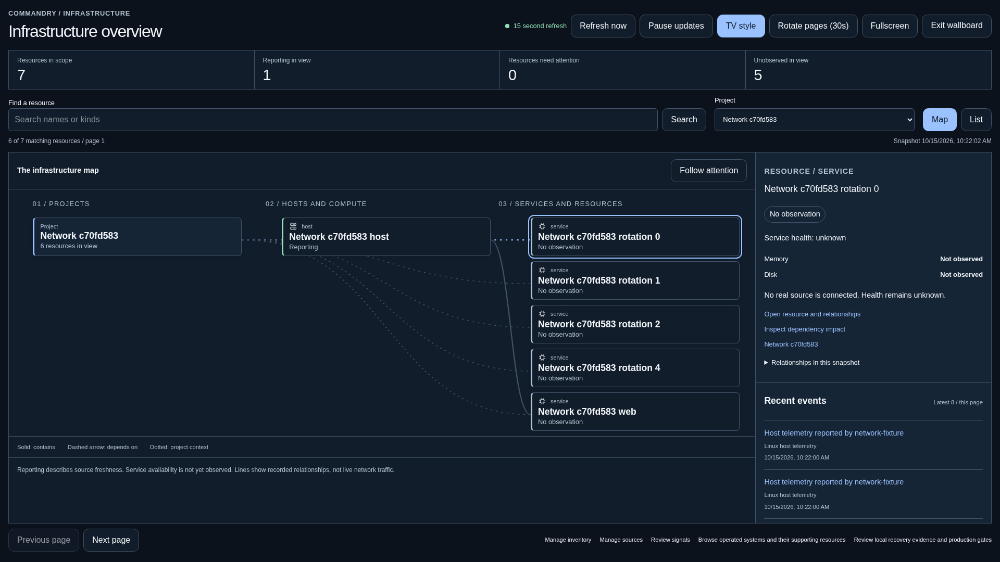

# Infrastructure network and wallboard

**Status: Operational; original local verification with production follow-up**

## Request and scope

Build an infrastructure-first overview from canonical Commandry records, with a
project/resource map, synchronized searchable list, source-backed inspection,
recent events, and a TV wallboard. Later agent and build-machine flows must use
these same entities and typed relationships, without inventing execution traffic.

## Research, 2026-10-15

Inspected the owner's signed-in InfraAgent dashboard, its organization map and
wallboard, and the local source at
`/home/urmani/Documents/Work/infra-agent/apps/dashboard/src/components/dashboard/monitor-org-map.tsx`.
The account has one application and 22 monitors. The useful patterns are summary
vitals, stable grouping, selected-service evidence, recent checks, full-window
presentation, incident focus, and a list alternative. The large central globe
leaves little space for operational detail; a resource-centered topology will
make hosts, services, and their context more legible at a distance. No InfraAgent
code or account data will be imported into the product.

Commandry already describes the intended projection in
[Infrastructure](../features/infrastructure.md) and
[Live system map](../features/live-system-map.md). Its real host samples measure
capacity and freshness, not external service availability. Existing normalized
events, sources, project links, containment, and dependency edges are sufficient
for the first read-only slice. No database migration or new provider is needed.

## Delivery plan

1. Add a versioned, paginated overview contract and application projection with
   a database adapter. Search and project scope operate on the complete eligible
   resource population. Project links and relationships retain stable identities.
2. Add the shared map renderer, inspector, capacity bars, and list view with
   source/freshness labels, empty/error states, and continuation.
3. Add a dedicated wallboard route using the same screen and data, device-local
   TV controls, optional native fullscreen, pause/resume, and attention focus.
   Refresh is explicitly polling, never described as a streaming transport.
4. Preserve the inventory editor and existing resource details. Add lab examples
   from the production renderer and meaningful projection, database, browser,
   accessibility, responsive, theme, and refresh-failure tests.
5. Run repository checks, tests, production build, and local browser verification;
   open a PR from `feat/infrastructure-network-wallboard` based on latest main.

## Boundaries

All controls in this slice are read-only or device-local presentation choices.
No infrastructure writes, deployment, source reconfiguration, alert suppression,
or agent dispatch are added. Existing signal review remains at its ordinary
route and retains its existing development-only limits. Source tools remain
systems of record. Metrics never propagate health from a host to its children.

The graph is a paginated viewport, with visible population/continuation counts;
it cannot silently imply the loaded page represents the whole fleet. Historical
activity is timestamped and links to exact source evidence. Attention focus
pauses after manual selection. Background sound remains silent.

## Implementation

- `GET /api/v1/infrastructure/overview` uses a Zod/OpenAPI contract, an
  application projection, and one read-only repeatable-read PostgreSQL snapshot.
  Cursor pages cover the entire eligible resource population. Search escapes
  wildcard characters; active project links define project scope.
- `packages/ui` owns the actual deterministic SVG/HTML renderer. Positions do
  not change when source status changes. Relation styles, text states, resource
  icons, keyboard focus, and a synchronized list preserve non-color meaning.
- The overview, inventory, and wallboard are separate routes. The shared screen
  cancels obsolete requests, prevents overlapping polls, suspends hidden tabs,
  retains delayed evidence on failure, and labels pause and snapshot time.
- Wallboard pages contain six resources, compared with 12 in the overview.
  Optional 30-second page rotation wraps through the complete scope and stops
  after manual selection. Attention focus rotates only among source problems in
  the current page. A manual inspection stops attention focus. Fullscreen is an
  optional enhancement; its rejection leaves the ordinary wallboard usable.
- A 1.4-second arrival cue represents only newly seen persisted events less than
  a minute old, after a baseline is established. Page changes are new baselines;
  paused, failed, and reduced-motion views do not animate traffic.
- Host memory/disk utilization, uptime, and load retain source evidence. The
  latest sample is chosen by occurrence time per source, so late arrival cannot
  replace newer capacity. Reporting does not propagate health to child services.
- The existing owner session middleware protects the new endpoint and wallboard.
  Device-local TV preferences are versioned. No external action policy, schema
  migration, dependency, or paid provider was added.

## Verification, 2026-10-15

| Check                          | Verified result                                                                                                                                                                                |
| ------------------------------ | ---------------------------------------------------------------------------------------------------------------------------------------------------------------------------------------------- |
| `pnpm check`                   | Formatting, lint, workspace types, boundaries, generated OpenAPI validation and lab isolation passed. Two pre-existing unused-argument warnings remain in `github-activity.test.ts`.           |
| `pnpm test`                    | 214 application/unit tests, two lab tests and 119 Node script tests passed; the final contract additions are included in the separate final unit run.                                          |
| Final Vitest run               | 216 tests passed, including overview scope and health-contract checks.                                                                                                                         |
| `pnpm test:integration`        | 90 PostgreSQL 18 and worker integration tests passed, including the new overview repository test under the application database role.                                                          |
| `pnpm build`                   | Production web and worker builds passed, with no lab artifact in production.                                                                                                                   |
| Scoped built-app browser suite | 18 checks passed on desktop, 390px and 320px viewports, including existing inventory, systems and recovery journeys.                                                                           |
| Final layout/browser pass      | Nine overview checks passed after the final spacing change, including a direct 1920x1080 viewport-height assertion and a 3840x2160 capture.                                                    |
| `pnpm test:auth-smoke`         | Local and provisional production password modes passed anonymous API/page denial, signed-in overview access, session revocation and offline owner recovery, using disposable local PostgreSQL. |

The reproducible scoped browser command is:

```bash
COMMANDRY_E2E_FILES=infrastructure-overview.spec.ts,resource-topology.spec.ts,systems.spec.ts,local-recovery.spec.ts pnpm exec node scripts/test-integration.mjs --real-browser
```

The browser harness starts the production build with disposable PostgreSQL and
cleans up its services/database. Its fixtures exercise the actual source receiver
and canonical APIs; they are synthetic local test data, not live owner telemetry.
The screenshot below is from that local 1920x1080 test.



### Findings corrected during verification

| Location               | Evidence                                                     | Correction and verification                                                                         |
| ---------------------- | ------------------------------------------------------------ | --------------------------------------------------------------------------------------------------- |
| Desktop overview       | The inspector squeezed the service lane at 1280px.           | Move the inspector below the map at that width; inspect the rendered result in light and dark mode. |
| TV wallboard           | Initial full-page 1080p capture was taller than the display. | Compact header, vitals and node spacing; direct viewport-fit assertion now passes.                  |
| Refresh failure test   | Next's route announcer also uses `role=alert`.               | Scope the assertion to the actual delayed-refresh message; all three viewport checks pass.          |
| Dependency impact link | The existing impact view is an anchor on the resource page.  | Link to `#dependency-impact`, retaining the canonical resource route.                               |

### Preview follow-up, 2026-10-15

The owner's narrow in-app browser exposed vertically clipped node names.
Preventing flex shrink on node labels and applying compact wallboard spacing at
all widths corrected it. The production build and all nine overview browser
checks passed again, now including a measured full-line-height assertion on node
names in every configured viewport and theme. The owner requested merging and
an interactive local preview; the preview is intentionally retained for review.

### Original local verification limits

No production deployment, infrastructure change, source reconfiguration, or
import of InfraAgent account data occurred. Physical-TV readability and remote
browser fullscreen policy were not tested on the owner's display. Local browser
viewports verify layout, not a specific television's overscan or viewing distance.
The current adapters measure host capacity and repository activity; external
service availability, production alert suppression, agents, prompt inspection,
and build-machine scheduling remain outside this infrastructure-first slice.

### Production follow-up, 2026-10-15

The overview, list, topology and TV wallboard are now deployed with Gravity as
the default presentation. The [Gravity activation record](gravity-infrastructure.md#production-activation-2026-10-15)
contains the exact production revision, image, release gates, preserved inventory
and signed-in browser evidence. The earlier screenshots and test counts above
remain historical local evidence. Obsolete task-owned local previews were
retired after the live result was verified.
