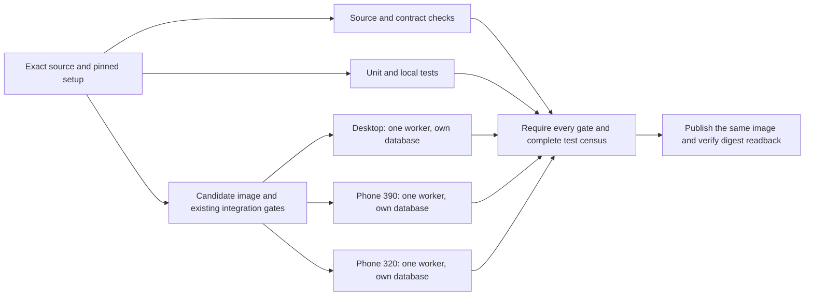

# Faster CI and consistent Commandry releases

**Status: Proposed implementation plan. Measurements are operational evidence; workflow changes and automatic deployment are not enabled by this document.**

## Decision proposed

Preserve the exact-image release contract and reduce elapsed time by running independent work on isolated machines. Start with the existing standard GitHub-hosted runners: separate source checks, unit/local tests, and candidate qualification; then run desktop, phone-390, and phone-320 browser jobs in parallel, one browser worker and one disposable database per machine. Publish only when every gate passes.

This uses infrastructure already operating for Commandry. A dedicated disposable local or homelab runner is a viable alternative and should be benchmarked before moving unattended releases onto it. Production should continue pulling a tested digest rather than compiling source on the application VPS.

This is a concrete proposal for owner confirmation before restructuring the workflow. It does not approve an automatic production deployment controller or a zero downtime topology change.

## What happens today

The accepted [deployment strategy](../../architecture/deployment-strategy.md) already separates builds from production. The [release workflow](../../../.github/workflows/release-candidate.yml) is manually dispatched on main and runs one serial ubuntu-24.04 job. Node and pnpm are pinned. It checks source/contracts, dependencies, unit/local behavior, populated database upgrades, the built application, browser journeys, governed owner workflows, exact-image production topology, provenance, and image vulnerability/secret gates. It then publishes the tested local image and checks the registry digest's image ID against the original.

The constrained production command consumes an exact approved digest, creates a fresh encrypted offsite backup, verifies isolated restore and host recovery, applies compatible migrations, replaces web/worker, and checks health, owner access, session revocation and a real worker job. It can restore the previous application image when verification fails. Database migrations remain forward. These controls remain requirements for the performance work.

The current deployment stops Caddy and Tunnel during the application switch. Faster CI will not make that switch zero downtime.

## Measured baseline

[Release 39165962511](https://github.com/iurman/commandry/actions/runs/39165962511), source `33d0086d5dd2efd08e9d567627cd00a77c2a5fad`, ran from `2026-10-18T21:01:37Z` to `21:38:32Z`: **36 minutes 55 seconds** of job execution. Queue time is separate.

| Stage                                            | Measured elapsed time |
| ------------------------------------------------ | --------------------: |
| Dependency/local setup                           |                  11 s |
| Source, contracts and workflow checks            |            2 min 29 s |
| Unit and local tests                             |            2 min 33 s |
| Upgrade audits, host application build and smoke |            4 min 31 s |
| Docker image build and Compose startup           |            1 min 48 s |
| Desktop and both phone browser projects          |           22 min 31 s |
| Governed owner workflows                         |            1 min 19 s |
| Production topology rehearsal                    |                  20 s |
| Both image scan passes                           |                  37 s |
| Registry publication and readback                |                   8 s |

Setup/cleanup and small intervening steps account for the remaining time. The browser report retained **207 identities: 202 passes, five original skips, no failures or flaky results**. Each viewport has 69 identities. Individual test durations sum to 606.237 seconds for desktop, 357.998 for phone-390 and 357.102 for phone-320. These sums are measured; they are not a parallel execution benchmark.

The corrected PR 40 [release 39169514777](https://github.com/iurman/commandry/actions/runs/39169514777) subsequently passed the same complete identity/skip census and all release gates. Its job took exactly 37 minutes and its browser stage 22 min 41 s. This corroborates the current critical path without supplying a parallel benchmark.

The previous successful [release 39113508421](https://github.com/iurman/commandry/actions/runs/39113508421) spent 25 min 31 s in browsers. Two runs establish a useful baseline, not a stable performance distribution.

The current longest desktop test took 208.18 seconds. Its attached master-scene phase log attributes 134.18 seconds to outline expansion and 1.73 seconds to fixture setup, using matched start/end timestamps by phase, theme and grouping. Some phase records overlap, so they are not an exclusive accounting of every second. The evidence points to rendered interaction work before fixture-seeding optimizations.

The first deployment in the [presentation rollout record](../../operations/observatory-presentation-rollout-2026-10-18.md) took about 106 seconds. The environment-update to backup-receipt interval was about 84.6 seconds, including Compose/database checks and backup/recovery. Most of it ran while the old release served traffic. Public sampling recorded nine HTTP 502/530 results during the switch, bounded by old-release success at `21:40:23Z` and new-release success at `21:40:44Z`. The approximately 21-second enclosing window is not an exact outage duration.

Raw reports, phase logs and private host receipts are retained in the rollout's private QA evidence. No credentials or private host inventory belong in this plan.

## First implementation: isolate and overlap existing work

The candidate path initially keeps both existing compilation paths and every audit, smoke, owner, topology and scan gate. Install Chromium in the candidate job as well as browser jobs: governed owner workflows currently reuse the browser installation from the earlier serial step. This avoids assuming that the host smoke harness and container build exercise identical contracts. Optimize duplicate compilation only after mapping their actual inputs and outputs.

The candidate job should export its tested image once. Each browser job downloads that artifact from the same workflow run, checks its checksum and source identity, loads it, and starts a fresh Compose/database stack without rebuilding. Standard runner isolation supplies separate ports, volumes and databases; do not run three browsers against the same small runner or shared application database. The previous two-worker contention failure is a reason to distribute machines, not to increase workers on one machine.

Generate the expected browser identity set from the selected commit with Playwright list mode, rather than freezing the current count forever. The current transition must conserve all 207 identities; later added tests extend the census. New or changed skips require explicit review.

The final publication job must require successful source, unit, candidate and all browser jobs. It loads the same image, verifies the original image ID and clean source labels, publishes, pulls the resulting immutable digest, and checks image ID equality. No build command belongs between successful qualification and publication.

Proposed implementation surfaces:

- `.github/workflows/release-candidate.yml`: job dependencies, minimal per-job permissions, explicit main publication guard and failure-safe cleanup.
- A small `scripts/ci/` image helper: export/load/verify and start an already-built candidate using existing local source/provenance rules. Preserve the existing developer `pnpm compose:up` behavior.
- A `scripts/ci/` browser-census helper: compare expected identities with all completed reports, reject missing/duplicate identities and verify the unchanged skip identities.
- Focused helper tests and disposable failure rehearsals. Keep real browser geometry, pointer, refresh and auth assertions.
- The deployment/developer workflow documentation and an operational timing summary.

A registry quarantine tag is an alternative to an Actions image artifact. It adds prequalification package writes and must never be treated as an eligible release. Start with a bounded artifact unless measured transfer/storage costs justify the registry alternative.

## Expected improvement and how to prove it

**Inferred first target: 20 to 25 minutes for complete qualification**, including all current gates. This is not a promised benchmark.

The browser critical path would move toward the longest isolated viewport, currently about 10.1 minutes of test execution rather than 22.5 minutes serially. Independent source/unit checks can overlap the candidate path. Artifact upload/download, fresh stack startup, runner queues and publication add overhead; measure them explicitly. A list-only six-shard census of the corrected source also conserves all 207 identities exactly once. Weighting those assignments with the measured serial test durations gives a heaviest lane of 397.913 seconds and other lanes of about 155 to 212 seconds. This is an inference, not a run: native sharding balances counts and concentrates the long desktop tests in one lane. It could improve on the 606-second desktop lane, but adding machines does not produce a proportional speedup.

After that experiment and a verified dependency map, consider running host integration/owner checks independently alongside image construction/topology/scans rather than keeping them on the image critical path. Combined with sharding, 10 to 15 minutes is a further hypothesis to benchmark. Keep the conservative first target until the actual graph and transfer/queue costs are measured.

Before making the new graph authoritative:

1. Retain the completed serial baseline and compare the same application code and immutable image where practical.
2. Run every viewport on its own machine with `--workers=1` and retries zero. Confirm all 207 identities exactly once, the same five skip identities, no unexpected failures or flaky outcomes, and unchanged assertion/deadline policy.
3. Verify source SHA, original image ID, artifact checksum and final digest readback across jobs. Publication must never rebuild.
4. In disposable qualification runs, fail one lane, remove a report, duplicate an identity, substitute a wrong SHA/checksum, and cancel a build. Every case must withhold release eligibility/publication and leave production untouched.
5. Run both cache-miss and cache-hit paths. An absent cache must only cost time; it must not bypass a check.
6. Record queue, setup, build, integration, browser, artifact and publication times separately. Compare an initial complete run and subsequent representative warm runs; report sample sizes, median and maximum rather than claiming a reliable tail latency from a tiny sample.

A failure is a reason to correct isolation/orchestration. It is not a reason to add retries, remove tests, raise deadlines, or waive the backup/restore and owner/worker gates.

## Cache and build work after the first measurement

Persist the pnpm store, Next build cache and BuildKit layers with keys scoped to toolchain, platform and lockfile/source inputs. Preserve clean-source and image identity checks. Main should own trusted cache writes; untrusted PRs must not obtain release credentials or poison trusted release state.

Prioritize by measured time. Dependency setup took only 11 seconds, so pnpm caching alone cannot remove the long wait. Next documents `.next/cache` persistence; Docker documents its Actions cache backend and compatible builder requirements. Bound cache export time and keep a working cold path. Runtime security package refresh and both scan policies must remain effective when layers are reused.

Map the host integration harness before removing duplicate compilation. Prefer exporting/reusing real build output or testing the exact container wherever equivalent assertions can be demonstrated. Do not delete auth-only smoke or populated upgrade audits as presumed duplicates. Browser download time is secondary to the measured render/interaction work. Preserve the master-scene fixture and every meaningful assertion while profiling its outline interactions.

## Where builds should run

| Option                                    | Fit and tradeoff                                                                                                                                                                                                                                                                                                                                                                                                                                                        |
| ----------------------------------------- | ----------------------------------------------------------------------------------------------------------------------------------------------------------------------------------------------------------------------------------------------------------------------------------------------------------------------------------------------------------------------------------------------------------------------------------------------------------------------- |
| Existing standard GitHub-hosted jobs      | Already operational and independent of Commandry availability. The repository is public; standard hosted runner minutes are currently free. Check artifact/cache retention and quotas separately. Splitting these jobs is the shortest path to a measured improvement.                                                                                                                                                                                                  |
| Dedicated disposable local/homelab runner | Preferred alternative to paid compute. Existing local Docker-compatible tooling was verified, but image-build and unattended-runner performance were not benchmarked. Use a separate VM, explicit resource budget and clean workspace, then compare cold/warm timings. Docker-compatible Compose discovery does not establish BuildKit cache compatibility; validate the chosen engine rather than assuming every cache flag works. It must remain awake and reachable. |
| Remote BuildKit on self-hosted capacity   | Keeps orchestration in Actions while moving compilation. Requires builder authentication/isolation, cache maintenance, reproducible source identity and availability. Benchmark before adding this boundary.                                                                                                                                                                                                                                                            |
| Production application VPS                | Keep it as an image consumer. Building and testing there couples release load and recovery to the service being updated.                                                                                                                                                                                                                                                                                                                                                |
| Paid larger hosted runners                | A fallback only if measured existing/self-hosted options cannot meet the target. No purchase is proposed.                                                                                                                                                                                                                                                                                                                                                               |

For self-hosted execution, keep public/untrusted PR code away from the desktop home, production credentials, broad tailnet access and privileged host sockets. Use isolated disposable workers and minimal tokens. Trusted main builds and untrusted PR validation need separate policies. A local machine's observed capacity is not an unattended availability guarantee.

## Consistency, triggers and the next deployment phase

Once the owner confirms the new workflow, add main-push qualification so both PR merges and direct main commits use the same release path. Keep PR validation separate from main publication. PR runs can cancel superseded work. Keep the current main qualification progressing and coalesce pending main work, preserving the existing non-cancellation policy: canceling every main build during continuous commits can prevent any release from finishing. GitHub concurrency is not a FIFO guarantee. Keep deployment locking/cancellation separate, and never interrupt an active database migration. A future automatic controller must explicitly choose tip-only promotion versus the latest qualified ancestor and prevent older results from replacing newer confirmed releases. Stable aggregate check names and explicit required-check policy should be reviewed before main protection changes.

Keep the existing constrained deploy command, exact digest, fresh backup/recovery, compatible migration, health/version, owner session and actual worker gates. Add safe per-stage timing before attempting to optimize the backup/recovery interval. Measure build latency separately from production activation latency and user-visible interruption.

Automatic deployment and zero downtime remain a separate, explicit design decision after the prioritized rollout. Their plan must cover independent supervision, candidate-versus-confirmed release state, traffic switching and draining, old-client asset compatibility, worker handover, migration compatibility and rollback. CI scheduling alone cannot supply those properties.

## Sources

- [Commandry release baseline](https://github.com/iurman/commandry/actions/runs/39165962511) and [previous successful release](https://github.com/iurman/commandry/actions/runs/39113508421): measured source, step and browser evidence.
- [Playwright sharding](https://playwright.dev/docs/test-sharding) and [parallelism](https://playwright.dev/docs/test-parallel): isolated-machine distribution and worker behavior.
- [GitHub Actions billing](https://docs.github.com/en/billing/concepts/product-billing/github-actions): current standard public-repository runner policy.
- [GitHub secure use](https://docs.github.com/en/actions/reference/security/secure-use): untrusted execution and self-hosted boundaries.
- [Docker Actions cache](https://docs.docker.com/build/cache/backends/gha/): cache export/import, driver compatibility and cache limits.
- [Next CI build caching](https://nextjs.org/docs/app/guides/ci-build-caching): persisting `.next/cache`.
- [Workflow concurrency](https://docs.github.com/en/actions/how-tos/write-workflows/choose-when-workflows-run/control-workflow-concurrency): separate cancellation and serialization policy.
