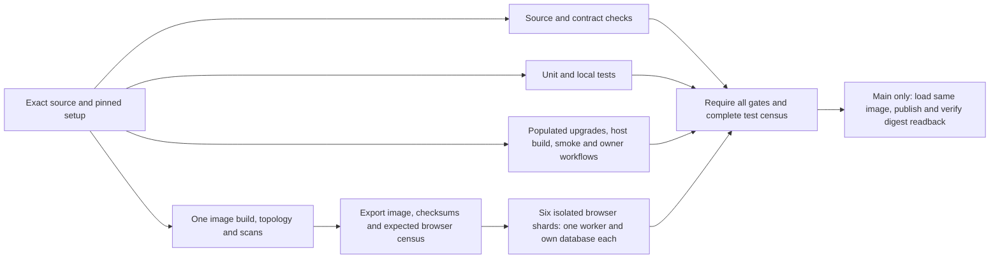

# Faster CI and consistent Commandry releases

**Status: Operational implementation. The owner's 10-15 minute target was verified on 2026-10-19: branch qualification 11m34s, main qualification/publication 9m51s. Automatic deployment is not enabled.**

## Owner target and implementation

Target **10-15 minutes for ordinary release qualification**, measured from the first job starting through final publication, with queue and production activation reported separately. The owner rejected the earlier 20-25 minute first target.

The implementation runs source checks, unit/local tests, populated upgrades/host builds/owner smoke, and exact-image construction/topology/scans independently. Six browser shards then load the same image into separate machines, each with one worker and its own disposable database. A final census requires every selected-source identity before main-only publication.

The 207 current browser cases are 69 journeys across three viewports. Cheap unit tests and independent browser checks do not need to extend the serial release path. The first benchmark retains every existing assertion; it does not assume that removing tests is necessary to meet the target. If actual latency exceeds 15 minutes, profile the critical path and classify redundant or exhaustive checks before changing release coverage.

This uses infrastructure already operating for Commandry. A dedicated disposable local or homelab runner is a viable alternative and should be benchmarked before moving unattended releases onto it. Production should continue pulling a tested digest rather than compiling source on the application VPS.

The owner authorized bringing release time down to 10-15 minutes. This implementation does not enable automatic production deployment or change the zero downtime topology. Main qualification remains manually dispatched during this measured transition.

## Previous serial workflow

The accepted [deployment strategy](../../architecture/deployment-strategy.md) already separates builds from production. The [release workflow](../../../.github/workflows/release-candidate.yml) previously ran one serial ubuntu-24.04 job dispatched on main. It now uses the parallel graph below. Node and pnpm are pinned. It checks source/contracts, dependencies, unit/local behavior, populated database upgrades, the built application, browser journeys, governed owner workflows, exact-image production topology, provenance, and image vulnerability/secret gates. It then publishes the tested local image and checks the registry digest's image ID against the original.

The constrained production command consumes an exact approved digest, creates a fresh encrypted offsite backup, verifies isolated restore and host recovery, applies compatible migrations, replaces web/worker, and checks health, owner access, session revocation and a real worker job. It can restore the previous application image when verification fails. Database migrations remain forward. These controls remain requirements for the performance work.

The current deployment stops Caddy and Tunnel during the application switch. Faster CI will not make that switch zero downtime.

## Concrete reliability correction before orchestration

The later [PR 41 release 39171649700](https://github.com/iurman/commandry/actions/runs/39171649700)
passed its populated upgrade assertions, then failed on an unhandled idle-pool
connection-termination error during disposable PostgreSQL shutdown. It never
published or deployed an image; the confirmed PR 39/40 release stayed live.

A real PostgreSQL probe reproduced the lifetime race: two connections existed,
but neither had emitted its physical end when `database.close()` returned.
`pg-pool` had drained its registry before socket completion. The database wrapper
now waits for each connected client's end after `pool.end()`, so the same probe
reports both connections ended before close returns. Unexpected pool errors and
shutdown rejections still propagate; no retry, delay or audit assertion was
removed. Five lifecycle regressions pass, and both actual upgrade audits passed
three consecutive executions each. The complete source checks passed.

This correction was merged in [PR 42](https://github.com/iurman/commandry/pull/42)
and passed the complete unchanged [main release 39174125292](https://github.com/iurman/commandry/actions/runs/39174125292).
The exact image was activated at `2026-10-18T23:33:59Z`; see the
[current-main rollout](../../operations/current-main-rollout-2026-10-18.md).
It is separate from the proposed job redesign. Complete qualification and
exact-image activation remain requirements for future changes. The
[node-postgres pool API](https://node-postgres.com/apis/pool) describes pool drain
and background errors; the additional completion invariant is backed by the
real probe and [lifecycle regression](../../../packages/db/src/client.test.ts).

## Measured baseline

[Release 39165962511](https://github.com/iurman/commandry/actions/runs/39165962511), source `33d0086d5dd2efd08e9d567627cd00a77c2a5fad`, ran from `2026-10-18T21:01:37Z` to `21:38:32Z`: **36 minutes 55 seconds** of job execution. Queue time is separate.

| Stage                                            | Measured elapsed time |
| ------------------------------------------------ | --------------------: |
| Dependency/local setup                           |                  11 s |
| Source, contracts and workflow checks            |            2 min 29 s |
| Unit and local tests                             |            2 min 33 s |
| Upgrade audits, host application build and smoke |            4 min 31 s |
| Docker image build and Compose startup           |            1 min 48 s |
| Desktop and both phone browser projects          |           22 min 31 s |
| Governed owner workflows                         |            1 min 19 s |
| Production topology rehearsal                    |                  20 s |
| Both image scan passes                           |                  37 s |
| Registry publication and readback                |                   8 s |

Setup/cleanup and small intervening steps account for the remaining time. The browser report retained **207 identities: 202 passes, five original skips, no failures or flaky results**. Each viewport has 69 identities. Individual test durations sum to 606.237 seconds for desktop, 357.998 for phone-390 and 357.102 for phone-320. These sums are measured; they are not a parallel execution benchmark.

The corrected PR 40 [release 39169514777](https://github.com/iurman/commandry/actions/runs/39169514777) subsequently passed the same complete identity/skip census and all release gates. Its job took exactly 37 minutes and its browser stage 22 min 41 s. This corroborates the current critical path without supplying a parallel benchmark.

The corrected PR 42 release subsequently took **38 min 17 s**. Its complete
browser step took **23 min 21 s**, including installation; the report measured
22 min 59.723 s of execution. All 207 identities and the five original skips
were preserved, with no failures, flaky results or retries. This is another
serial baseline, not a measurement of the proposed parallel workflow.

The previous successful [release 39113508421](https://github.com/iurman/commandry/actions/runs/39113508421) spent 25 min 31 s in browsers. The retained runs establish a useful baseline, not a stable performance distribution.

In the PR 40 release, the longest desktop test took 208.18 seconds. Its attached master-scene phase log attributes 134.18 seconds to outline expansion and 1.73 seconds to fixture setup, using matched start/end timestamps by phase, theme and grouping. Some phase records overlap, so they are not an exclusive accounting of every second. The evidence points to rendered interaction work before fixture-seeding optimizations.

The first deployment in the [presentation rollout record](../../operations/observatory-presentation-rollout-2026-10-18.md) took about 106 seconds. The environment-update to backup-receipt interval was about 84.6 seconds, including Compose/database checks and backup/recovery. Most of it ran while the old release served traffic. Public sampling recorded nine HTTP 502/530 results during the switch, bounded by old-release success at `21:40:23Z` and new-release success at `21:40:44Z`. The approximately 21-second enclosing window is not an exact outage duration.

Raw reports, phase logs and private host receipts are retained in the rollout's private QA evidence. No credentials or private host inventory belong in this plan.

## Implementation: isolate and overlap existing work

Host and container compilation both remain covered, on independent machines.
Chromium is installed in the host integration job for its governed owner
workflows and independently in browser jobs. No duplicate gate was removed on
an assumption of equivalence.

The image job exports a gzip archive plus its image ID, source, run/attempt,
archive checksum and selected-source browser census checksum. The immutable
producer outputs bind downstream consumers independently of the downloaded
metadata. Every browser job verifies these values, loads the image, and starts
Compose with `--no-build`. Source/image/health are checked again after tests.
The existing developer `pnpm compose:up` behavior is unchanged.

The aggregate job rejects missing or duplicated shards/cases, new skips,
failures, flaky results, retries, changed worker/retry settings and tampered
artifacts. Expected identities come from the selected commit, rather than a
permanently fixed test count. The five current skips have an explicit reviewed
policy. Added tests extend the census; added skips require a policy change.

Publication requires successful source, unit, host integration, image and all
six browser jobs plus the complete census. A separate main-only job receives
package-write permission, loads the same image, verifies source/image identity,
pushes and compares the pulled digest's image ID with the original. Branch
benchmark runs qualify without publication. There is no rebuild after tests.

Implementation surfaces:

- `.github/workflows/release-candidate.yml`: isolated jobs, six browser shards, failure-safe dependencies/cleanup and main-only package writes.
- `.github/actions/release-setup/action.yml`: pinned setup and exact clean source checks.
- `scripts/ci-release.mjs`: export/load/checksum/source/run/image checks, no-build startup and aggregate browser census.
- `scripts/ci-browser-skips.json`: the five reviewed original skip identities.
- `scripts/ci-release.test.mjs`: source/attempt/output substitution, archive/census corruption, missing/duplicate results, retries/failures and skip changes fail closed.
- Deployment/developer workflow documentation and measured execution records.

A registry quarantine tag is an alternative to an Actions image artifact. It adds prequalification package writes and must never be treated as an eligible release. Start with a bounded artifact unless measured transfer/storage costs justify the registry alternative.

## Expected improvement and how to prove it

**Performance target: 10-15 minutes for complete qualification and publication.**
The [execution record](../../operations/ci-performance-2026-10-19.md) verifies
11m34s branch qualification and 9m51s main qualification/publication, plus
66s/3s of initial queue time respectively. All 207 identities and the original
five skips are retained. The main result reduces measured elapsed execution
by 74.3 percent from the serial 38m17s baseline. These two samples do not
establish a stable percentile.

A prior list-only six-shard census conserved all 207 identities exactly once.
Weighting its assignments with measured serial test durations predicted a
heaviest lane of 397.913 seconds, with the others around 155-212 seconds.
Native Playwright sharding balances test counts, so the long desktop tests can
still concentrate in one lane. This is an inference, not a parallel benchmark.

The image build/start previously took 113 seconds. Its topology/scan/export
work adds to that path before browsers; independent host build/upgrade/owner
work can overlap it. A roughly seven-minute browser lane plus image, transfer,
stack startup and publication overhead supports testing the 10-15 minute goal.
Queue delay, cold downloads, archive size and actual lane imbalance must be
measured separately. Paid runners are not proposed.

If this graph misses the target, first inspect the measured slow lane and image
transfer. Then classify release-critical browser journeys versus exhaustive
render/width/fixture sweeps and move only explicitly reviewed redundant or
broader coverage to separate runs. Keep sign-in/denial/session revoke, primary
read/write flows, health, worker completion, compatible migrations, exact-image
identity, scans and deployment recovery as release gates.

Adoption evidence and repeatable checks:

1. Retain the completed serial baseline and compare the same application code and immutable image where practical.
2. Run six shards on isolated machines with `--workers=1` and retries zero. Confirm all 207 identities exactly once, the same five skip identities, no unexpected failures or flaky outcomes, and unchanged assertion/deadline policy.
3. Verify source SHA, original image ID, artifact checksum and final digest readback across jobs. Publication must never rebuild.
4. Focused tests exercised failed/retried lanes, missing/duplicate reports and identities, wrong source/run/attempt/image metadata, corrupt checksums and changed skips. The first actual branch run also rejected dirty source and withheld qualification. Deliberate cancellation/registry failure drills remain controller validation before automatic promotion; they were not performed in this performance task.
5. No Next/BuildKit cache optimization was introduced. Keep cache-miss/cache-hit comparisons as follow-up benchmarking; these two runs did not control every tool cache. Cache presence cannot bypass a check.
6. Raw per-job/per-step times and separate initial queue times were retained. There is one successful branch qualification sample and one main publication sample. Gather more representative runs before reporting a stable median, maximum or tail latency.

A failure is a reason to correct isolation/orchestration. It is not a reason to add retries, remove tests, raise deadlines, or waive the backup/restore and owner/worker gates.

## Cache and build work after the first measurement

Persist the pnpm store, Next build cache and BuildKit layers with keys scoped to toolchain, platform and lockfile/source inputs. Preserve clean-source and image identity checks. Main should own trusted cache writes; untrusted PRs must not obtain release credentials or poison trusted release state.

Prioritize by measured time. Dependency setup took only 11 seconds, so pnpm caching alone cannot remove the long wait. Next documents `.next/cache` persistence; Docker documents its Actions cache backend and compatible builder requirements. Bound cache export time and keep a working cold path. Runtime security package refresh and both scan policies must remain effective when layers are reused.

Map the host integration harness before removing duplicate compilation. Prefer exporting/reusing real build output or testing the exact container wherever equivalent assertions can be demonstrated. Do not delete auth-only smoke or populated upgrade audits as presumed duplicates. Browser download time is secondary to the measured render/interaction work. Preserve the master-scene fixture and every meaningful assertion while profiling its outline interactions.

## Where builds should run

| Option                                    | Fit and tradeoff                                                                                                                                                                                                                                                                                                                                                                                                                                                        |
| ----------------------------------------- | ----------------------------------------------------------------------------------------------------------------------------------------------------------------------------------------------------------------------------------------------------------------------------------------------------------------------------------------------------------------------------------------------------------------------------------------------------------------------- |
| Existing standard GitHub-hosted jobs      | Already operational and independent of Commandry availability. The repository is public; standard hosted runner minutes are currently free. Check artifact/cache retention and quotas separately. Splitting these jobs is the shortest path to a measured improvement.                                                                                                                                                                                                  |
| Dedicated disposable local/homelab runner | Preferred alternative to paid compute. Existing local Docker-compatible tooling was verified, but image-build and unattended-runner performance were not benchmarked. Use a separate VM, explicit resource budget and clean workspace, then compare cold/warm timings. Docker-compatible Compose discovery does not establish BuildKit cache compatibility; validate the chosen engine rather than assuming every cache flag works. It must remain awake and reachable. |
| Remote BuildKit on self-hosted capacity   | Keeps orchestration in Actions while moving compilation. Requires builder authentication/isolation, cache maintenance, reproducible source identity and availability. Benchmark before adding this boundary.                                                                                                                                                                                                                                                            |
| Production application VPS                | Keep it as an image consumer. Building and testing there couples release load and recovery to the service being updated.                                                                                                                                                                                                                                                                                                                                                |
| Paid larger hosted runners                | A fallback only if measured existing/self-hosted options cannot meet the target. No purchase is proposed.                                                                                                                                                                                                                                                                                                                                                               |

For self-hosted execution, keep public/untrusted PR code away from the desktop home, production credentials, broad tailnet access and privileged host sockets. Use isolated disposable workers and minimal tokens. Trusted main builds and untrusted PR validation need separate policies. A local machine's observed capacity is not an unattended availability guarantee.

## Consistency, triggers and the next deployment phase

After the parallel graph is benchmarked and adopted, consider main-push qualification so both PR merges and direct main commits use the same release path. Keep PR validation separate from main publication. PR runs can cancel superseded work. Keep the current main qualification progressing and coalesce pending main work, preserving the existing non-cancellation policy: canceling every main build during continuous commits can prevent any release from finishing. GitHub concurrency is not a FIFO guarantee. Keep deployment locking/cancellation separate, and never interrupt an active database migration. A future automatic controller must explicitly choose tip-only promotion versus the latest qualified ancestor and prevent older results from replacing newer confirmed releases. Stable aggregate check names and explicit required-check policy should be reviewed before main protection changes.

Keep the existing constrained deploy command, exact digest, fresh backup/recovery, compatible migration, health/version, owner session and actual worker gates. Add safe per-stage timing before attempting to optimize the backup/recovery interval. Measure build latency separately from production activation latency and user-visible interruption.

Automatic deployment and zero downtime remain a separate, explicit design decision after the prioritized rollout. Their plan must cover independent supervision, candidate-versus-confirmed release state, traffic switching and draining, old-client asset compatibility, worker handover, migration compatibility and rollback. CI scheduling alone cannot supply those properties.

## Sources

- [Commandry release baseline](https://github.com/iurman/commandry/actions/runs/39165962511) and [previous successful release](https://github.com/iurman/commandry/actions/runs/39113508421): measured source, step and browser evidence.
- [Playwright sharding](https://playwright.dev/docs/test-sharding) and [parallelism](https://playwright.dev/docs/test-parallel): isolated-machine distribution and worker behavior.
- [GitHub Actions billing](https://docs.github.com/en/billing/concepts/product-billing/github-actions): current standard public-repository runner policy.
- [GitHub secure use](https://docs.github.com/en/actions/reference/security/secure-use): untrusted execution and self-hosted boundaries.
- [Docker Actions cache](https://docs.docker.com/build/cache/backends/gha/): cache export/import, driver compatibility and cache limits.
- [Next CI build caching](https://nextjs.org/docs/app/guides/ci-build-caching): persisting `.next/cache`.
- [Workflow concurrency](https://docs.github.com/en/actions/how-tos/write-workflows/choose-when-workflows-run/control-workflow-concurrency): separate cancellation and serialization policy.
