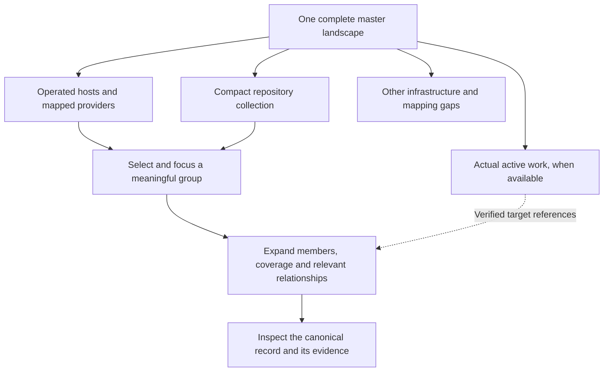

# Observatory: a meaningful operational landscape

**Status: Proposed. Planning only. Implementation is not authorized by this document.**

**Prepared:** 2026-10-16. **Source baseline:** `507303ca1e82b8b15cc8d94864b61db1de86ed7e`.

## 1. Outcome and planning boundary

Keep the Gravity Observatory identity: sculpted wells, a quiet illuminated field, useful camera movement and an inspectable miniature world. Make the world explain what is operated, where it runs, what needs attention and what is being worked on. A directory of repositories must not overwhelm real infrastructure or masquerade as monitored services.

The owner requested research and a handoff-ready plan before any fixes. No renderer, CSS, schema, resource mapping, source integration, credential, production setting or accepted ADR is changed by this planning packet. No implementation chat, worker or watcher is launched. Existing local previews and the separate runtime-workflow chat remain available.

This plan proposes the following product decision: **one complete master landscape, with truthful aggregate representations and progressive detail, rather than one equally prominent well for every inventory row.** Every authorized resource remains represented, counted, searchable and inspectable without visible resource pages. Expansion changes detail inside the same landscape; it does not navigate to another fleet page.

Read [research and evidence](RESEARCH.md), [acceptance scenarios](ACCEPTANCE.md) and the [implementation handoff](HANDOFF.md) with this plan. Recommendations below are proposed behavior, not claims about shipped features.

## 2. What is wrong and why the previous checks missed it

The saved production-derived inventory contains 91 resources: 60 repositories, 18 hosts and 13 services. There are 70 records without a primary parent, 48 repositories without any project link, and seven resources with multiple project links. All 91 have null structured resource state. Four hosts have capacity observations; all 91 infrastructure health values are explicitly unknown. These are snapshot facts, not a current check of every underlying system.

The current projection assigns every root record the renderer kind `host`, including repository roots. Consequently the scene has 70 main wells. Host mode does not create meaningful operational sectors, and the project chosen for a multi-project resource is the first sorted UUID. Source freshness drives attention; availability has no implemented provider. The visual similarities therefore exceed what the data can justify.

The previous pilot verified complete inventory retrieval, GPU contribution coverage, selection, focus mechanics and release safety. Those checks did not establish useful operational hierarchy, readable silhouettes at fleet scale, menu fit at wrapping boundaries, or the ability to identify the right affected system within seconds. The new acceptance bar includes those questions.

Other source findings:

- Appearance is an absolutely positioned form inside an overflow-clipped card, with right alignment and no viewport collision handling. Increasing z-index cannot solve clipping.
- A fixed terrain evaluation budget reduces mesh density as the population and field extent grow. Renderer updates also pass previous and next wells together to terrain planning, counting unchanged identities twice for that calculation. This is a strong explanation for loss of detail, to isolate in a regression test before fixing it.
- Labels repel and compete in screen space. A label can become visually distant from its subject, while many root labels compete for the same small projected region.
- The lens duplicates a large part of the viewport, stays at a fixed position and primarily exposes direct nested service wells. It is not a complete detail-navigation model.
- A local recorded copy naturally becomes stale. Its stale sources must not be presented as fresh production failures or fabricated live traffic.

## 3. Questions the overview must answer

After a short glance, the owner should be able to answer:

1. Which operated systems have a confirmed issue or need a decision?
2. Which hosts and providers run the relevant deployments?
3. What is monitored, what is unmonitored and what is stale?
4. Is an external incident relevant to those dependencies, or just background context?
5. What work is active, and which repository, deployment or service does it actually concern?
6. What changed, when, and where can its evidence be opened?

The scene must also work with motion disabled, without a pointer and without WebGL. A synchronized outline and inspector carry the same meaning as the terrain.

## 4. Proposed default composition

Use an **operational landscape** as the default named view. Compose it into a small number of stable areas with open space between them. The grouping has meaning before animation is added.

### 4.1 Operated infrastructure

Hosts with recorded services, an active telemetry source, an explicit operated role or an owner pin receive prominent host basins. Nested machines remain inside their actual host context. Logical application/service groups unfold on terraces around the host, using recorded System/resource associations or explicitly labeled project-support groupings.

Unknown-role hosts remain accounted for in an expandable Other infrastructure collection. A phone, workstation or historically retired machine must not automatically look like an active production server. The current subtype prose can inform a review proposal; it is not a structured lifecycle field and must not silently classify or retire a device. The owner can pin any important unmonitored device, such as a home automation hub, into the overview.

A critical signal on a collapsed member is visible on its parent summary and in the attention rail. Grouping must never hide the only indication of a real problem.

### 4.2 Providers

Cloudflare, IONOS or another verified provider forms a broad enclosing halo or shallow basin. Its account and product-specific deployment groups appear inside it when their mappings are recorded. Provider identity is quiet; current impact is a separate badge/rim treatment.

For Cloudflare, distinguish Workers, Pages, Tunnel, DNS and backing products such as D1, KV or R2. A deployment may depend on several of them. Do not create a false physical server for a globally distributed Worker. Do not infer that a Cloudflare-proxied URL is hosted on Workers, or that every Cloudflare incident affects it.

The current infrastructure snapshot does not establish a Cloudflare account/deployment inventory. Until mappings exist, ResuPals must remain a known repository/project with an unconfirmed deployment mapping. Its placement under Cloudflare is a target experience, not a discovered fact.

### 4.3 Repositories

Represent repositories together as a compact etched collection or constellation, not as 60 production-like craters. The overview label gives the total and supported activity/security coverage, such as repository count, active recorded work and unresolved observed findings. Missing coverage is explicit.

Expanding the collection groups by a chosen meaningful dimension, initially project or repository owner. Forty-eight unlinked repositories are Unmapped, not Undeployed: no recorded mapping is not proof that nothing is deployed. Archived, paused and historical categories require explicit lifecycle evidence.

A repository with a recorded deployment gains a cross-reference to that deployment. Selection reveals the relationship. The same repository keeps its identity in its collection and in project/provider views; a reference is not a second resource.

### 4.4 Active work

When real run/Work/PR data is available, show a compact work dock and bounded status markers near relevant groups. A working repository can have an offset highlight or small raised tab, connected to its canonical location by a short tether. Do not move its permanent position out of the collection merely because an agent begins work.

Only real attributed work can produce Working, Waiting for input, Waiting for approval or Failed markers. A recent commit, this chat being active, or a manually launched Codex worker is not automatically a Commandry AgentRun. Integrate with the separate runtime workstream's accepted contract; do not build a competing dispatcher here.

PRs initially appear as counts and selected-repository details. They do not all become permanent terrain nodes. Failed PR checks describe development state, not an outage of the currently deployed service.

### 4.5 Global context and attention

Use a restrained Commandry origin/compass rather than a giant central object that consumes the useful scene. A slim attention rail lists confirmed impacts, potential provider exposure and missing observations separately. Unrelated provider notices remain available in an advisory drawer, collapsed by default.

For the current data, the first honest overview can emphasize the four observed hosts, known nested resources, repository collection and other infrastructure. It cannot honestly show 13 healthy services or a complete Cloudflare fleet yet.

This is a composition/navigation sketch, not a discovered topology or a replacement for the Gravity treatment:



## 5. Visual grammar

- **Host:** a smooth, round gravity basin. Size reflects a stable structural quantity, normally distinct nested operational resources. Storage/compute profiles may differ subtly when role is known; random polygon silhouettes have no meaning.
- **Deployment/application group:** a smaller related basin or terrace with a clear parent boundary, environment label and service-coverage summary.
- **Provider:** a broad halo/boundary around its relevant deployments, with a provider glyph and product badges.
- **Repository:** an etched tile or compact point cluster, visibly different from a running service. Repository collections do not contribute a terrain hole per repository when collapsed.
- **Agent/run:** a small fixed-slot work marker with a task-state badge. Decorative orbiting is optional and never hides the actor or status.
- **Aggregate:** an explicit count, expansion affordance and state breakdown. It is never a mysteriously larger anonymous well.

Use sector color sparingly for identity. Use a separate semantic status channel for impact, coverage and work. A purple project must still show an unambiguous red incident badge. Shape/icon and text accompany every color. The legend explains only visible concepts.

Keep service-count sizing as the default where it applies. Count unique represented descendants of the chosen operational grouping, not duplicate aliases or repository counts from a different semantic category. Apply a bounded visual scale so one large host does not swallow the landscape; show the exact count in text. RAM is an optional capacity lens only where actual total RAM is available. Never infer total RAM from percentage used, give unknown capacity a zero-sized well, or resize on every utilization sample. Preserve the user's selection if a size lens is unavailable and explain missing values.

## 6. Hierarchy, identity and grouping rules

The current core model already distinguishes Project, System, Resource and typed relationships. Reuse it. A project is not necessarily a deployed application, a System is not an arbitrary folder, and a provider is not a project created for visual convenience.

The scene is a projection over those canonical records:

1. Authorize every source entity and relationship before aggregation.
2. Classify representation using explicit kind, verified relationships and reviewed operational role/lifecycle metadata.
3. Choose group membership from the named view. Preserve actual containment independently of project associations.
4. Compute unique counts, coverage, relevant signals and a complete membership index.
5. Produce aggregate nodes, expansion paths, optional reference instances and evidence-bearing edges.
6. Lay out this projection deterministically, then render it. Rendering never invents relationships or decides health.

Every canonical resource in scope has at least one visible aggregate or expanded representation. The union of membership sets equals the authorized population. A global count counts each canonical ID once. A resource may be referenced in several groups, and each reference identifies that fact; per-group counts need not add to the global unique count. Missing parents and partial permissions do not reveal hidden names or hidden counts.

For a resource in several projects, do not choose its primary presentation context by UUID order. A saved view may select a preferred context. Otherwise place it under its physical/provider context and list all authorized project associations, or use a labeled Shared collection. Do not manufacture ownership.

Support the previously requested host, project and custom-sector views as presets of the same projection. Add a provider view and retain a complete inventory-oriented view. Custom sectors can independently group by host, project, provider or resource kind. Manual arrangement changes presentation only; it does not reparent a canonical resource or deploy it.

Named views should support scope, layout/grouping per sector, expansion policy, pins, size basis, camera, theme and semantic palette. Keep transient selection/hover separate. Device-local preferences remain supported. Cross-device named views require explicit owner-scoped persistence and access rules; do not silently publish them or place private identifiers in share URLs.

## 7. Stable layout and semantic detail

Do not run a perpetual physics simulation on the inventory. Use stable group IDs, saved anchors, deterministic packing, reserved expansion space and incremental insertion. A new resource appears inside the correct group; a new group enters an available nearby region. Unaffected groups keep their positions. Status changes do not repack the map.

There are three detail levels in one scene:

1. **Overview:** provider/host/collection summaries with a few readable state counts. Repositories and service children are aggregate members, not competing labels.
2. **Group focus:** expand one chosen group, show its deployments/services or repositories, and simplify unrelated groups without losing their summaries or critical badges.
3. **Resource focus:** inspect one entity, its evidence, direct dependencies, work and environment. Expand further nested groups through breadcrumbs.

Detail responds to explicit selection and available pixels, with hysteresis to avoid flicker near zoom thresholds. A crowded region aggregates into a labeled collection instead of drawing microscopic wells. No fixed resource limit, first-N label rule or hidden resource page can be used to pretend the scene is complete. Very large views use spatially indexed visible representations and complete membership/search, not a shader that evaluates every inventory row at every vertex.

Overview defaults to a steady, elevated three-quarter camera chosen for readable separation. Limit low grazing angles in automatic presentation modes; manual exploration can still go lower. Group borders, containment spacing and leader lines explain relationships even when perspective overlaps. If every group cannot fit with readable labels, aggregate a semantic level higher and expose its count. Do not claim that thousands of individual labels can be readable simultaneously.

## 8. Focus, navigation and the optional lens

The default primary interaction is **select to focus and inspect**, without first toggling a magnifier:

- Click/tap or activate a group to smoothly focus and reveal its next meaningful level. Open the corresponding inspector and a breadcrumb back to the master view.
- Select a resource to inspect its identity, actual kind, placement, known health, observation age, recent changes and evidence. It need not navigate away from the scene.
- An explicit Open resource action goes to the canonical record. Do not make one click both select a node and navigate away.
- Back or Escape returns to the prior camera/expansion/selection state. Close a popover before changing the scene level. Preserve search and parent context.
- Clicking empty space does not erase useful context unexpectedly; provide an explicit Overview action. Initial load must not auto-focus the first UUID as if the user selected it.

Keep the circular lens as an optional inspection tool. It should show a useful selected-group detail pass, selected identity, child summary and metrics/evidence, rather than duplicate the whole overview. On desktop place it in available space or let the owner pin it; draw a clear tether to its subject. Proposed starting size is 240-320 CSS pixels, constrained by actual available stage area. Fit the main camera around the inspector/lens reservation. Do not cover the selected node, essential controls or attention rail.

On narrow screens prefer an expandable bottom detail sheet and an optional selected well close-up. A giant fixed lens that occupies most of a phone is not the default. Its controls need the same keyboard and viewport protections as other overlays.

Selecting another entity updates the existing detail surface smoothly; it does not create another lens. Collapse/reparent/removal while selected resolves to the nearest still-authorized context, with a clear removed/unavailable message when required. Permission loss must not retain hidden labels in caches or history previews.

## 9. Motion and TV behavior

Composed is the default. Distinguish ambient decoration from data activity. Quiet light texture and a slow floor sweep can preserve the observatory character while labels, well centers and status text remain stable. Ambient displacement must not move semantic anchors or alter the perceived health/count.

Retain opt-in Slow orbit and Guided tour. Orbit moves the camera around stable groups at a readable elevation. Tour visits meaningful groups, not every repository, and uses approach, dwell and retreat phases. A group remains named and its state remains visible throughout. After direct selection, keyboard interaction or dragging, stop automatic camera control until explicit Resume tour/orbit. Never resume while the owner is reading an inspector.

Use one animation-clock owner per scene. Avoid competing springs, CSS transitions and collision solvers fighting over the same label. A label stays tethered to its semantic anchor; suppress an optional label before repelling it so far that it names the wrong well. Selected groups and meaningful attention retain labels, while aggregate summaries preserve access to suppressed member details.

New members can ease into an existing collection once. Sample updates do not replay arrivals. Real events can produce a small bounded pulse at their subject. Travel between subjects requires a real relation/event with origin and destination; a static dependency is not measured network traffic. Stop data activity on stale/disconnected feeds. Replay is labeled and has its own clock. No initial snapshot fireworks or backlog replay on returning to a tab.

TV mode uses readable group names and summary numbers, restrained controls, optional incident following, no unsolicited sound, and no page rotation. A selected view stays still unless its camera mode is intentionally enabled. Reduced motion stops camera autoplay and ambient motion, while keeping selection and state changes fully usable.

## 10. Truthful state and aggregation

Do not flatten all conditions into one red/green resource status. Each item can have independent availability, source freshness, capacity, security, lifecycle, provider exposure and work state. All carry source, observed-at time, freshness rule and evidence reference.

Recommended semantic treatments:

- **Red / Confirmed impact:** a current failing monitored requirement, confirmed security incident or explicit critical policy condition on an authorized subject. Text states which kind. It does not automatically mean every service is down.
- **Orange / Potential exposure or degradation:** a matched provider incident without confirmed local failure, a measured degradation, or a defined warning condition. Show the reason and certainty separately.
- **Gray / Advisory:** a provider notice without a known dependency match. It is context, not an open local incident.
- **Neutral outlined / Unknown or unmonitored:** no qualifying observation, stale/failed coverage or missing mapping. Do not conflate this with unrelated advisory gray; use different glyphs and text.
- **Green / Passing observed checks:** only fresh qualifying health evidence within the stated coverage. Never use collector freshness, an existing URL, an open TCP listener, successful CI or an absence of alerts as a substitute.
- **Distinct cool accent / Active work:** queued/running/review state. This does not overwrite availability or security state.

A summary exposes unique required services, passing/degraded/failing/unknown/maintenance counts and coverage. Example fixture wording: `6 services: 4 passing, 1 failing, 1 unmonitored`, not `5/6 operational`. If only four of six requirements are observed and all pass, say `4 monitored checks passing; coverage incomplete`. Zero eligible checks means Not monitored, not 100 percent uptime.

A required failing member raises confirmed impact. A noncritical optional failure remains visible with its role rather than declaring the application down. Maintenance, expected-offline development and retired assets have explicit policy and do not vanish from inventory. Acknowledging/snoozing an alert does not change its underlying observed state. An inherited incident badge is a reference to one incident, not a newly counted outage at every ancestor.

Freshness ages from observation time, not scene refresh time. Last-known passing evidence that expires becomes unknown/stale, not indefinitely green. Provider-feed failure is feed unavailable, not provider healthy. Conflicting sources remain inspectable; do not erase a failing observation because a different collector reports.

## 11. Cloudflare and other provider incidents

Cloudflare's official [status API](https://www.cloudflarestatus.com/api) exposes structured summaries, components, unresolved incidents and maintenance. Its [support documentation](https://developers.cloudflare.com/support/cloudflare-status/) also lists separate incident and maintenance RSS/Atom feeds. Prefer structured JSON for deterministic matching and use feeds for compatibility or history links. Do not scrape the dashboard or use browser cookies as connector credentials.

Match incidents against explicit resource/account/provider-product dependencies and applicable geography/environment. Store severity and relevance separately. A major global indicator alone is insufficient. Distinguish control-plane failures, such as inability to deploy, from data-plane service availability. A Workers app is not automatically affected by WARP, Pages, or a specific remote location incident.

For each notice expose one of: confirmed local impact, potential relevant exposure, advisory with no known match, or relevance unknown because mapping is incomplete. Do not use No impact when it really means Not checked. A direct failing availability check can confirm local impact; attributing that failure to the provider remains a separate causal claim unless evidence establishes it.

All fetched provider notices may be stored in a bounded history, but only relevant exposure or confirmed impact belongs in the main attention lane by default. Unrelated notices remain visible on provider selection/in its advisory drawer. Unmapped dependency coverage is disclosed. Provider RSS ingestion never creates production actions or sends notifications automatically.

Proposed connector defaults for implementation review: one server-side poller per provider endpoint, approximately two-minute polling with jitter, conditional requests where supported, Retry-After/backoff, explicit timeout and response-size limits, and a ten-minute fetch-freshness warning. These are starting policies to validate, not provider guarantees. Do not poll once per viewer or deployment.

Normalize incident identity, update identity, source component IDs, event/status times, maintenance window and evidence URL. Deduplicate repeated feed/API deliveries, preserve updates and resolution, handle out-of-order records and provider renames by stable ID, and reconcile against successful complete unresolved snapshots. The recent-50 feeds are not proof of complete historical coverage. An empty failed/truncated fetch cannot resolve an existing incident. Render external content as sanitized text; never execute HTML, follow embedded agent instructions or fetch arbitrary incident-body URLs.

Provider API status does not inventory the owner's account. Optional Cloudflare deployment discovery requires separately scoped read access. Use official account/script/deployment identities, and model multi-version rollout or multiple environments without treating a listed Worker as proof of endpoint health. [Worker deployment APIs](https://developers.cloudflare.com/api/resources/workers/subresources/scripts/subresources/deployments/) are a source for release state, not an external availability monitor.

## 12. Repository security, PRs and agent work

Repository security is an observation of supported scanners/manual reports, not a claim that a repository is uncompromised. GitHub exposes [secret scanning](https://docs.github.com/en/rest/secret-scanning/secret-scanning) and [code scanning](https://docs.github.com/en/rest/code-scanning/code-scanning) through distinct APIs/permissions. Coverage, plan availability, branch/ref, age, inaccessible scans and excluded findings must remain visible. A zero-result scan does not establish absence of compromise. A manual unverified report remains Reported, with attribution and review state.

PR summaries need real repository/PR IDs and current state from a supported source. [Deployment records](https://docs.github.com/en/rest/deployments/deployments) can link a commit/environment to release state, but project co-membership and a GitHub activity event do not establish an actual repo-to-service deployment. Multi-repository apps, monorepos, several deployments of one repo, previews and canaries must be representable.

A run marker identifies the real run or explicitly recorded external session, related Work, target repository/resource, state, update age and evidence link. A missing heartbeat becomes connection unknown under the accepted runtime policy, not a silently completed agent. Keep agent waiting/failed, build failed, repository findings and service health as separate facets. The new runtime chat owns real dispatch; this workstream consumes approved contracts when they exist. Fixtures can preview the visual behavior but never enter production as observed runs.

## 13. Data architecture and missing mappings

Reuse canonical resources, projects, Systems, their links, real integration envelopes, metric/event history, Work and accepted run records. Keep domain classification/aggregation in domain/application packages, persistence in reviewed PostgreSQL migrations and provider parsing in adapters. React and shaders consume a projection; they do not decide deployment truth or permissions.

Add only missing bounded concepts after schema/ADR review:

- Structured operational role, environment and lifecycle annotations with actor, provenance, version and audit; preserve existing IDs and subtype prose.
- Typed repo-to-deployment, deployment-to-execution-target and deployment-to-service associations where existing relations cannot express them. Existing host containment remains unchanged. A logical deployment can reference services physically parented under a host; do not reparent them into a fake folder to draw an application.
- Provider/account/product dependency mapping, with stable external identifiers, scope, environment/geography applicability and evidence.
- Independent observation facets, coverage requirements, incident relevance evaluations and their explanatory evidence.
- A versioned scene projection and, separately, owner-scoped named view configuration if shared persistence is approved.

Conceptual examples, not inferred live topology:

```text
Host -> actual guest/container/service containment
System/application -> its explicitly linked services
Repository -> deployment -> execution target and service instances
Resource/deployment -> provider products it actually depends on
Real run -> Work -> repository/resource targets
```

The saved data confirms Electra has Commandry service records and an Ephemera database record. It does not establish a complete Ephemera app deployment, nor that Merope runs Ephemera. ResuPals is a recorded repository/project; its Cloudflare target needs independent mapping evidence. Proposed source/name heuristics may generate a reviewable mapping proposal, never silently persist it as fact.

Keep mapping gaps visible and actionable. Provide a bounded review screen that previews suggested links with their basis, supports expected-version conflict checks, and applies only approved changes. Multiple homes are supported by typed relations and reference instances. Primary-parent cycles remain invalid; general dependency cycles are traversed safely and explained.

Preserve the existing flat infrastructure API and clients. Prefer an additive scene/projection contract rather than overloading `health: unknown` with new meanings or changing repository resources into new IDs. It should carry source/population/version metadata, aggregate membership/counts, expansion paths, canonical references, per-facet evidence and authorized relation types. Follow all continuation and maintain last complete scene on refresh failure. Do not claim that a sequence of live page reads is an atomic database snapshot.

### Proposed contract to pin before worker dispatch

Use these responsibilities as the initial interface design, with final schemas/route/tool identifiers reviewed together before parallel implementation:

- **Scene envelope:** schema version, authorized scope digest, named-view revision, projection revision, read-start/read-complete times, source/facet freshness, canonical unique population counts, root representation IDs and continuation. Revisions distinguish structural changes from ordinary observation updates. A read time is not a measurement time.
- **Representation:** stable representation ID, canonical entity reference or aggregate identity, explicit representation kind, parent representation ID, authorized related project references, display label, stable layout key, member count/digest, expansion/member-query reference and separate summary facets. Representation IDs distinguish aliases; layout keys do not change when counts or names change.
- **Membership read:** group ID plus scope/projection revision, complete server-derived count, authorized canonical references, continuation and completeness state. Do not inline an unbounded member array into every ancestor. Expanding a group must not stitch members from different scopes/revisions together.
- **Signal:** subject reference, facet, observed state, source ID, observation/expiry times, evidence references, applicable environment and coverage requirements. Unknown, unsupported, unavailable, disabled and stale are distinct reasons, not zeroes.
- **Provider exposure:** source incident/update IDs, affected provider component IDs, configured dependency match and its provenance, applicable environment/geography, relevance classification, independently observed local impact, and causal attribution status. Provider severity never directly becomes local impact.
- **Relationship:** registered type, exact authorized source/target references, lifecycle, provenance and evidence. A visual tether between aliases is explicitly a reference, not an invented canonical dependency.
- **View configuration:** owner/scope, expected version, grouping/sector rules, pins/positions, expansion policy, camera/size/appearance roles and schema version. Canonical mapping edits are separate commands with their own authority and audit.

Facets can become unavailable independently. A security endpoint failure should not blank an otherwise complete inventory, and a loaded inventory must not mark missing security/work facets current. Scope changes and permission revocation invalidate the appropriate caches. A whole-application aggregate must not include unauthorized child evidence or reveal its existence through a private total. Filtered totals, hidden-by-view counts and full authorized inventory totals are labeled separately.

For the first 91-resource delivery, complete existing continuation can feed the projection while new fields come from shared authorized services. Before larger-scale lazy loading, define a revision-bound membership protocol and test its consistency; do not bolt lazy loading onto mutable UUID cursors and claim a complete stable graph. Server aggregation/search and graphics level of detail solve different scaling problems.

## 14. UI, API and MCP parity

Agents need the same intelligible grouping and source explanations as the owner. The implementation must include discoverable, separately scoped read tools for scene summaries, complete aggregate membership, typed relations, signal evidence and provider relevance explanations. Tool names and capability identifiers are to be finalized with the foundation contract, not treated as already shipped.

Authorize source entities before every count, label, edge and inherited alert. A scene read grant does not automatically grant Work, run, security, private-provider-account or cross-project access. The legacy knowledge MCP's four read tools remain unchanged. Do not broaden existing foundation grants by changing the contents of their results.

Record each new action's operation, risk, required scope/capability, approval behavior and audit:

- Reading a scene, members or signal evidence is read-only within granted facets and project scope, with existing material-read audit conventions.
- Changing a personal display preference is a reversible presentation action, with explicit persistence scope. Device-local lens/theme controls can remain owner UI-only with that intentional boundary documented.
- Editing operational metadata, canonical relations or incident relevance overrides is a versioned reversible canonical write requiring exact edit scope, provenance and immutable audit. An agent suggestion is a proposal until policy authorizes applying it.
- Connecting an account, issuing credentials, enabling a source or expanding disclosure remains owner-governed. Source credentials stay outside ordinary views, knowledge, screenshots and logs.
- Acknowledging/snoozing an alert is a distinct audited action. Restarting a host, deploying code or asking an agent to act uses the existing action/approval model and is outside this visualization change.

Actual MCP tests must compare authorized results with UI/API application-service results, including denied entities, aggregate counts, shared-resource aliases and continuation. Interface documentation alone is not parity evidence.

## 15. Renderer approach and quality floor

Keep Three.js/WebGL2. The observed problems do not justify changing engines or moving to WebGPU. Three.js provides [instancing](https://threejs.org/docs/pages/InstancedMesh.html) and [level of detail](https://threejs.org/docs/pages/LOD.html); application semantics and mesh design still determine readability.

During implementation, first build a small shared-renderer study with the real 91-resource distribution and a dense adversarial fixture. Compare the existing summed field against a hybrid with a quiet common floor and locally detailed, smoothly joined basin patches. Preferred direction is localized radial geometry/analytic contours for prominently rendered basins, with detail allocated by projected size and curvature. Keep circular silhouettes smooth at overview and focus; collapsed member counts must not consume terrain resolution. Use instancing for repeated glyphs/rings and spatial lookup for active fields where useful. Do not introduce a separate lab-only rendering engine.

The study must demonstrate continuous floor/patch joins, no outline shimmer or z-fighting, consistent picking, sensible shadows/normal treatment, correct far/near bounds and the selected well still readable on a constrained device. If a different implementation meets these criteria more simply, record the measured comparison rather than forcing the proposed mesh shape.

Repair the previous/next duplicate-ID terrain budget issue through an explicit unique-identity transition model. Preserve actual entering/exiting items during transitions. Do not revert to the old 64-field limit. Replace the former test requirement that every inventory resource must always be a separate GPU well with conservation of all membership IDs plus coverage of every active rendered representation. GPU storage/evaluation completeness tests remain necessary for those representations.

Use safe quality tiers and expose diagnostics: population, aggregate/member counts, rendered representations, draw calls, geometry/texture memory, selected detail, frame intervals and stale state. Proposed targets: a settled overview at least 30 fps on the actual baseline desktop, no sustained degradation on a 30-minute TV soak, and usable input/fallback on a real lower-powered device. Record browser, hardware, viewport, DPR, scene size and measurement method. A frame interval is not a GPU-time measurement. Lower decorative detail/DPR/update rate before reducing semantic coverage. Do not publish unmeasured device claims.

## 16. Shared overlay contract across Commandry

Treat the Appearance defect as a shared interaction requirement, not a one-off CSS offset. Audit actual floating controls and their consumers. Ordinary inline disclosures are not popovers and need not be converted.

Provide one reusable surface contract for anchored form panels, action menus, tooltips and dialogs, preserving each role's semantics. Prefer existing accepted accessible primitives when present. Native [popover top-layer behavior](https://developer.mozilla.org/en-US/docs/Web/API/Popover_API) and [anchor fallback positioning](https://developer.mozilla.org/en-US/docs/Web/CSS/Reference/Properties/position-try-fallbacks) are useful mechanisms, with compatibility checks and a tested fallback. A complex Appearance form is not an ARIA menu. A portal implementation must choose the correct fullscreen/dialog root; portaling to body blindly can place a control outside the active fullscreen surface.

Contract: fit within the visual viewport and safe areas; flip/shift/resize as needed; bound height and allow internal scrolling; preserve labels and reachable dismissal; reposition on scroll/resize/zoom; support 200 percent zoom, software keyboard and long localized text; close or reanchor safely when the trigger unmounts; restore focus; and prevent scene drag/zoom from consuming form interactions. A too-small viewport uses a suitable sheet/dialog rather than clipping controls.

Follow the [WAI dialog pattern](https://www.w3.org/WAI/ARIA/apg/patterns/dialog-modal/) where modal behavior is actually used. Non-modal controls do not trap focus or mark the rest of the app inert. Layering order is explicit, nested Escape behavior predictable, and tooltip content is never the only access to required information.

Prove the clipping defect fails before the shared repair with actual visible-control bounds/hit tests, not just `toBeVisible`. Check all discovered floating consumers and the lab specimen. An increased z-index, removed clipping on every page or one viewport screenshot is not a site-wide fix.

## 17. Delivery order after explicit owner release

### A. Lock meaning and baseline

Re-read current main and the owner decisions, preserve the 91-resource baseline and user screenshots, record actual source/runtime revisions, and agree the proposed projection decision. Prepare an ADR that supersedes only ADR 0015's per-resource GPU-well implication, preserving complete populations, canonical IDs and no visible pages. Allocate its number from the current ADR index; the runtime workstream may have added one.

Deliverable: accepted meaning/interaction contract, mapping gaps and test fixtures. No silent reclassification or new integrations.

### B. Reliable controls and readable geometry

Implement the shared overlay contract with regression evidence, then the localized basin quality study and terrain-budget regression. This can use existing data without waiting for provider tokens. Keep the actual production UI and shared renderer as the source of truth.

Deliverable: controls usable at wrapping boundaries and smooth, identifiable wells across overview/focus. Present actual rendered results early so the owner can steer before the visual vocabulary is treated as final. After explicit approval of this plan, ordinary implementation and evidence milestones do not each require another permission prompt.

### C. Complete grouped landscape and focus

Implement deterministic aggregation, meaningful kind representations, all presets/custom sectors, complete membership/search, selection-driven expansion/inspector and the smaller optional lens. Preserve preferences through a versioned migration. Validate the real mixed inventory, not only a fixture made of identical hosts/services in one project.

Deliverable: readable-inventory release candidate with honest unmonitored/unknown state. Do not call it a fully monitored operational view yet.

### D. Canonical mappings and operational signals

Add reviewed additive schema/services/relations only where needed. Apply a reviewed initial mapping batch, ingest public provider status with relevance tests, and connect at least one supported real availability source for a genuinely deployed service. Prefer an existing monitor/provider adapter, potentially InfraAgent if its supported authenticated read contract is verified, over building a replacement uptime platform. Do not assume a logged-in browser session is a service integration.

Deliverable: operational release candidate with at least one real application whose summary and failure/recovery reflect timestamped external evidence. If access is unavailable, clearly mark the connector blocked and keep the readable inventory deliverable separate. No fabricated green fleet.

### E. Repository/work overlays and saved views

Add real PR/security adapters within approved read scopes, and consume actual runtime work contracts when ready. Supply owner-scoped named views/per-sector grouping and TV modes. Keep unavailable integrations visibly unsupported without fake agents, findings or example data in production.

Deliverable: the broader control-plane view the owner described, with each enabled facet verified independently. A repository security audit/automatic operational action is not bundled into drawing its badge.

### F. Integration and release

Independent review, real disposable PostgreSQL and actual GPU/browser verification, complete MCP parity, accessibility, responsive/theme/TV checks and a measured soak. PR descriptions distinguish shipped visual improvements from inactive adapters and owner-only mappings. Preserve required CI, normal hooks, backup/restore, constrained deployment and explicit release authority. No merge/deploy is authorized by this planning request.

After a later delegation request, independent source ownership can split overlay primitives, projection/domain contracts, renderer quality and read-only provider ingestion once their interfaces are pinned. Do not assign those workers the same file or let a renderer choose domain policy. The root integrator owns visual direction and the complete real-data result.

## 18. Product decisions to confirm with the plan

Recommended defaults for owner review:

1. Operational landscape as default; repositories remain a compact visible collection rather than individual overview craters.
2. A click focuses/expands and opens details; the circular lens is optional.
3. Still composed view by default; orbit/tour are deliberate presentation modes.
4. Green requires observed passing health; provider relevance and missing coverage get their own treatments.
5. Readable inventory can ship before every optional connector, but it is not labeled fully monitored until real availability evidence is wired.

Remaining owner-only inputs are exact initial deployment/provider/account mappings where evidence is missing, any new read credentials, and any policy for notification/escalation. Those choices must be previewed concretely, not asked as a broad architecture questionnaire. They do not block designing or testing the generic projection. This planning packet is ready for review and handoff; implementation starts only after the owner releases the hold.
