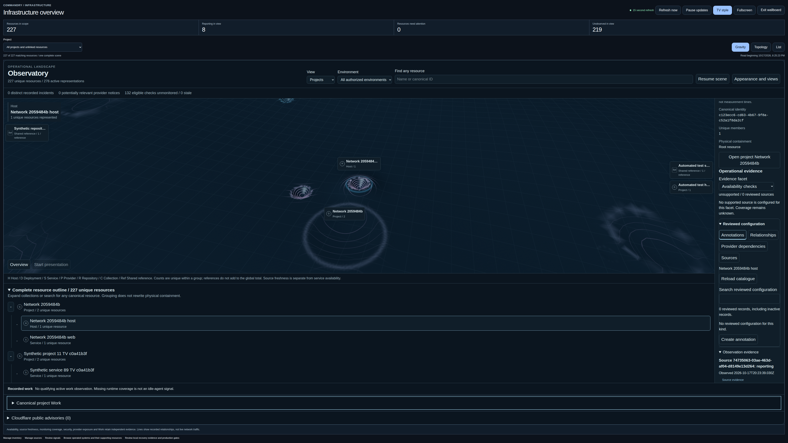

# Published Observatory release candidate

**Status: Operational. Published-candidate collection snapshot retained. The subsequent approved production rollout is recorded separately.**

[Production rollout](PRODUCTION-ROLLOUT.md) completed at 22:12:43 UTC on 2026-10-17 for this exact revision and image. The approval/deployment fields below describe the earlier collection time, not current production state.

[Release 39065358282](https://github.com/iurman/commandry/actions/runs/39065358282) completed successfully at 2026-10-17T20:44:55Z for main revision `885b356876a94adfae5c2c5c5c743c3cb866845b`. [PR28](https://github.com/iurman/commandry/pull/28) normally merged the independently reviewed release-only single-worker override. Application, tests and default local worker count remain conserved as recorded in [T43](T43.md).

## Exact candidate

| Field                            | Verified value                                                                                     |
| -------------------------------- | -------------------------------------------------------------------------------------------------- |
| Target                           | production                                                                                         |
| Revision                         | `885b356876a94adfae5c2c5c5c743c3cb866845b`                                                         |
| Image                            | `ghcr.io/iurman/commandry@sha256:605e90004c9f596dc990faa611d4e9d189275f9bc83996df2ca5cf5bb6d4c80c` |
| Image creation time, UTC seconds | `2026-10-17T20:18:18Z`                                                                             |
| Platform                         | linux/amd64                                                                                        |
| Source clean                     | true                                                                                               |
| Approval                         | Not created                                                                                        |
| Deployment                       | Not performed                                                                                      |

The collector verified the published tag against the raw manifest hash and registry content digest, then verified the image configuration byte hash, revision, clean-source label, creation timestamp and platform. It used an anonymous registry pull token and made no production change. The full run also passed disposable owner workflows, the production-service rehearsal, clean-image provenance, existing image-security gates and digest publication/readback. [Sanitized evidence](evidence/2026-10-17-serial-main-release.json) binds these observations to this exact run.

## Browser result and limits

Independent comparison verifies every original file/title-lineage/project identity: 207 unique cases, 69 per viewport, with 202 actual passes, exactly the five original skips, zero failures, zero flakes and zero retries. The original identity digest is unchanged. The three cases that failed in T42 now pass. The browser suite reports 1381241.289 ms, approximately 23 minutes. This is completion under one-worker scheduling, not a rendering-speed measurement, a causal explanation or equivalent inter-test concurrency. Earlier failed runs remain failed historical evidence.

The actual image-scan summary reports 43 high findings with no reported fix, zero critical findings, zero fixable high/critical findings and zero secret findings. The existing policy reports unfixed findings without blocking publication. Passing this gate does not establish a vulnerability-free image.

## Genuine protected deployment gate

The existing [deployment control](../../../deploy/README.md#constrained-deployment-command-installed-but-unconfigured) requires an authorized operator to install the root-owned mode-0600 `/etc/commandry/approved-release` record. Its seven fields are `TARGET`, `IMAGE`, `REVISION`, `BUILD_TIME`, `APPROVAL_ID`, `APPROVED_BY` and `EXPIRES_AT`. The first four immutable candidate values are above. The approval ID, approver and future expiry within one day must be genuine operator decisions; they have not been invented or written by this task. The constrained deployment identity can only trigger the approved record and cannot edit it. Its SSH authentication triggers deployment, so it has not been probed.

After that gate, the existing forced workflow must complete fresh encrypted offsite backup, exact restore and recovery checks before migration or replacement. Current live revision, signed-in behavior, canonical inventory/parent/link preservation and actual Commandry source/mapping activation will be verified afterward. No production SQL or unrelated service change is authorized by this candidate.

## Actual hosted screenshots

These are captures from this exact successful release's disposable synthetic inventory, not live production observations. They supplement the executed tests. The global screenshot contains the test world's accumulated 227-resource population; the focused fleet contains 103 resources. Their counts must not be confused with the recorded 91-resource production baseline.

[Desktop focused fleet](evidence/2026-10-17-ci-release-desktop.png) and [390px phone capture](evidence/2026-10-17-ci-release-phone-390.png) retain their full original pixels.

## Remaining scope

The [coverage ledger](COVERAGE.md) retains B05 unsupported incident snooze evidence, E07 genuine document-hidden verification, F04 physical mobile keyboard/safe-area verification, F06 actual owner interpretation and G06 lower-powered physical-device verification. Unreleased AgentRun is still unavailable. GitHub polling still requires verification of an existing authorized reader credential. Ephemera discovery remains non-blocking; InfraAgent, CRM and Arvo remain repository inventory/design-reference scope. These limits and the pending production gates prevent a whole-workflow completion claim.
